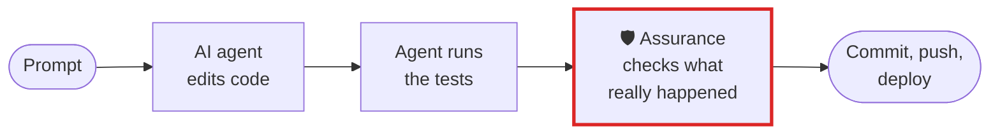

# Use cases

Pick the one closest to your work. Each page says what goes wrong without Assurance, where it sits in
the workflow, the few lines that set it up, and what it does not do.

| Your work | What goes wrong | Where Assurance sits |
|---|---|---|
| [Payments and fintech](payments.md) | Money code ships on the agent's "done", with the ledger test last run before the fix | Your declared tests must pass after the last edit; a push over untested billing code is a stop |
| [Banking and regulated change](banking.md) | No evidence of what an agent changed, what was tested, or who was allowed to | A JSON record per session, and a clearance check against `CODEOWNERS` before review |
| [Healthcare and life sciences](healthcare.md) | An agent "tidies" patient fixtures or installs a package that runs a script | Protected paths named when changed; installs read before they run; MCP tools pinned |
| [Legal, insurance and documents](legal.md) | A confident answer from four of the six documents it needed | Required vs. retrieved, by name; missing periods in a folder of reports |
| [Platform, DevOps and SRE](platform.md) | An agent pushes, deploys or migrates over code nothing tested | Stop and check on the ship; what a change reaches; limits a session cannot raise |
| [Teams building their own agents](agent-builders.md) | The gate said allow, the run said done, and the check failed | A run record or your OTel traces, audited; a verdict your code can stop on |
| [Pharma, clinical and validated systems](pharma.md) | A change to validated code, evidenced by a summary the model wrote about itself | A record produced by arithmetic, the same bytes every time it is asked |
| [Energy, utilities and critical infrastructure](energy.md) | An AI tool cannot be allowed inside the boundary, so agents are refused outright | The whole audit runs with no network and no model; installs read before they run |
| [Safety-critical software](safety-critical.md) | Four of the six requirements got a test, and the trace matrix says it is done | Requirements against coverage, both directions named, with an exit code |

Every page has its own workflow diagram. The general shape is the same everywhere:

The red box is Assurance. Everything around it is your workflow as it is today.

New to it? Start with the [README](../../README.md): one command shows what your last Claude Code
session did and did not check.

## Every claim on these pages is tested

A use-case page is marketing until something runs it. So each claim here has a scenario behind it
that builds the situation the page describes -- files in a project, and a transcript in the shape
Claude Code writes -- runs the real command, and asserts what comes back:

- [`packages/budget/tests/test_use_case_scenarios.py`](../../packages/budget/tests/test_use_case_scenarios.py)
  -- the session pages: payments, banking, healthcare, platform, agent-builders, pharma, energy.
- [`packages/cli/tests/test_use_case_scenarios.py`](../../packages/cli/tests/test_use_case_scenarios.py)
  -- the retrieval and traceability pages: legal, safety-critical.

Each one is paired with its counterfactual: the same situation with the cause taken out, which has
to come back quiet. A check that fires at everything would satisfy the first half on its own, and a
test that only ever sees the finding it expects cannot tell the two apart.

It is worth saying what that found. Writing these turned up a real defect in the claim *"a run of
zero tests is called that, not a pass"*: under `pytest -q` -- the form these very pages prescribe --
a suite whose every test was skipped was recorded as a passing run, because the empty-run check
keyed on the `=` banner that `-q` suppresses. The project's own test for it was labelled `pytest -q`
and supplied the banner anyway, so the quiet form had never been under test.

Fixed, and then the fix was reviewed in a fresh context and found incomplete in the same way: it read
the summary a *short* suite prints, and pytest appends ` (H:MM:SS)` past sixty seconds, so it did
nothing for long suites — which is where skips conditional on a database or an API key live. The
review also found it had made a command that is two runners (`ctest && pytest -q`) report "ran no
tests" while naming the runner that had just run five. Both are now resolved by counting test
segments, each with its own counterfactual.
