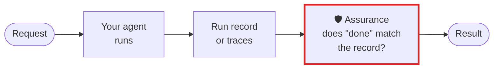

# Teams building their own agents

**Your agent's gate said "allow" and its last message said "done". Assurance holds both against what
then happened, from a run record or the OpenTelemetry traces you already send.**

## What goes wrong

A policy or a fast decision model allows a step, and the step's own check fails. A blocked step runs
anyway. The run ends with *"Done: the tests pass"* over a failed `pytest`. Your tracing shows every
span, and none of them says the run's claim was false.

## The workflow, with Assurance in it



The red box is Assurance. Everything around it is your workflow as it is today.

## Set it up

No SDK is needed: one line of JSON per thing the agent does. Or let the recorder write it:

```python
from assurance_budget.record import Recorder

with Recorder("run.jsonl", limits={"frontier_calls": 50, "seconds": 900}) as rec:
    rec.task("Fix the refund rounding", must_run=["ruff check ."], expect=["reports/refunds.csv"])
    client = rec.watch(anthropic.Anthropic())   # or openai.OpenAI(): its calls are recorded
    ...
    rec.claim("Done")
```

Already sending traces? Add one exporter, or point any OTLP exporter at the local endpoint:

```bash
assurance serve &
OTEL_EXPORTER_OTLP_ENDPOINT=http://127.0.0.1:4318 python my_agent.py
curl -s "http://127.0.0.1:4318/v1/runs/refund-42?fail_on=claim,outcome" | jq -e .verdict.passed
```

## What you get

- The run's last word held against the record: a failed check, an expected output never written, a
  must-run command that did not run after the last edit.
- Every gate measured by what the step then did: an allowed step that failed, a blocked step that ran.
- Limits your code can lower and never raise, set in the operator's own settings.

## What it does not do

It reads only what the record or trace carries, never a prompt or a reply unless your instrumentation
records them, and sends nothing anywhere.

[Your own agent, in full](../guide/your-own-agent.md) · [All use cases](README.md) · [Back to the README](../../README.md)
