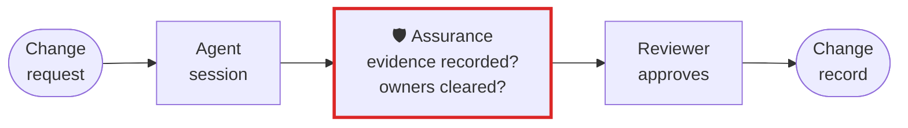

# Banking and regulated change management

**Every change an agent makes needs evidence a reviewer can check: what changed, what was tested
after it, who was allowed to make it. Assurance writes that evidence from the session itself, on your
machine.**

## What goes wrong

Change management asks *who changed what, was it tested, and was it approved*. An agent session
answers none of that by itself. It ends with a summary written by the same model that did the work,
and a reviewer has to trust it or reread the transcript. Many regulated teams stop there and keep
agents out entirely, because nothing they have can show what an agent did and nothing else.

## The workflow, with Assurance in it



The red box is Assurance. Everything around it is your workflow as it is today.

## Set it up

Turn the hook on for the repository, so every engineer's sessions are audited the same way:

```bash
uvx assurance@latest hook install --scope project
```

Keep the audit of each session with the change it produced. It is JSON, written by code from the
transcript, with no model involved:

```bash
assurance audit --json > evidence/change-1234.json   # the latest session in this folder
assurance audit --session <id> --json                # or one session, by its id
```

Ask, before review, whether the person who asked for the change is cleared for every owner it
reaches. Owners come from `CODEOWNERS`, reach from a code graph, and clearance from a declaration you
keep:

```bash
graphify update .                                      # builds graphify-out/graph.json, no model
assurance clearance src/payments --declaration principals.json --principal alice
```

Exit `1` means not cleared, or something it could not determine, such as a file no `CODEOWNERS` rule
covers. Either way it tells your workflow to route the change to someone who is cleared. It decides
from the declaration and the graph, and no one's clearance is lent to the person who asked.

## What you get

- A record per session of what was edited, what ran after the last edit and how it ended, what your
  last prompt named and what happened to it, and what could not be classified.
- A clear line between what was checked and what was not: an unclassified command is named, never
  counted as a pass, and a run of zero tests is called that, not a pass.
- It knows a Java shop's commands out of the box: `./mvnw verify`, `./gradlew check`, `mvn -DskipTests
  package` (compiled, tested nothing), and the scripts in your `Makefile`.
- Nothing leaves the machine. It calls no model and no network service, so it can run where agents
  are otherwise refused.

## What it does not do

It is not a compliance certification, and it does not approve changes. It gives the people who
approve them evidence they can check without trusting the agent's summary.

[All use cases](README.md) · [Back to the README](../../README.md)
