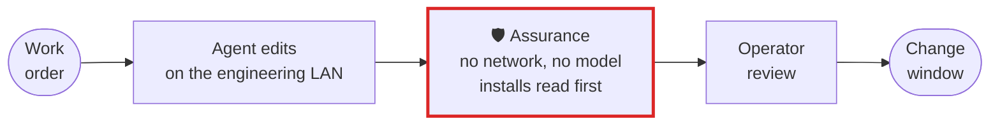

# Energy, utilities and critical infrastructure

**Inside an OT boundary the question is not only what the agent did, but what the tool watching it
talked to. Assurance runs the whole audit with no network and no model, on the machine, and reads an
install before anything executes.**

## What goes wrong

The engineering network has rules an AI tool usually cannot meet: nothing calls out, nothing ships a
transcript to a vendor, nothing new runs on a machine that reaches a control system. So agents are
refused outright, or allowed only on an island where the real code is not. When one is allowed, the
risk that matters is rarely the edit — it is a dependency whose install script runs on a build host
inside the boundary, or a change to control configuration that nobody asked for.

## The workflow, with Assurance in it



The red box is Assurance. Everything around it is your change process as it is today.

## Set it up

Name the configuration a session must not change, and the check that must have passed after the last
edit:

```toml
# .assurance/config.toml
[audit]
must_run = ["pytest -q tests/test_limits.py"]
must_not_touch = ["control/", "profiles/", "*.scl"]
```

Read what an install is about to execute, before it executes. It never runs the package, and never
opens the network:

```bash
assurance deps requirements.txt     # or package.json: reads the lockfile and what is on disk
```

On a machine with nothing cached there is nothing to read, and it says so and exits `1` rather than
reporting a clean result: *"Nothing was read, so nothing is reported about install-time code. This is
silence, not a pass."* That is the answer you want inside a boundary — point it at a populated wheel
cache, `node_modules` or a lockfile and it reports what the install would run.

## What you get

- **An audit that opens no socket.** The whole `audit` command runs with the socket layer refusing
  connections, and still produces the full report. This is tested with the refusal proven to bite,
  because "nothing connected" is also what a broken test says.
- **No model in the path.** Every answer is arithmetic over what happened. Nothing is sent anywhere
  to be summarised, so there is no transcript leaving the boundary to review in the first place.
- **Installs read, not run.** `deps` reads a lockfile and what is already on disk, and reports the
  install scripts a package would execute. It does not execute them.
- **Control configuration named when it changes.** A path under `must_not_touch` that a session
  changed without your prompt naming it is reported, by name.

## What it does not do

It is not a network control and it is not a NERC CIP assessment. It does not sit between the agent
and anything — it reads what a session did, after the fact, and says what was not checked.

Tested: [`test_energy_the_whole_audit_runs_with_networking_refused`][t], which asserts the refusal
fires on a real connection attempt before trusting the audit's silence.

[t]: ../../packages/budget/tests/test_use_case_scenarios.py

[All use cases](README.md) · [Back to the README](../../README.md)
