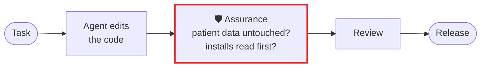

# Healthcare and life sciences

**Agents near patient data have to stay out of what they were not asked to touch, and every check has
to run where the data is. Assurance runs locally, and names any protected path a session changed.**

## What goes wrong

An agent asked to fix a report query also "tidies" a fixture of patient records, or the de-identification
config, because it was nearby. A new package it installed runs a script on a machine with clinical data
on it. The MCP server it calls for the EHR changed a tool's description since your security team
approved it. None of these show up in the agent's summary.

## The workflow, with Assurance in it



The red box is Assurance. Everything around it is your workflow as it is today.

## Set it up

```toml
# .assurance/config.toml
[audit]
must_not_touch = ["data/", "fixtures/patients/", "config/deidentify.yaml"]
must_run = ["pytest -q tests/test_deidentify.py"]
```

`must_not_touch` takes paths as `.gitignore` does. A turn that changes one without your last prompt
naming it gets a **suggested review**, and a session that edits `.assurance/config.toml` does not get
to use what it declares there, so an agent cannot take a path off the list to pass its own audit.

Before installing anything on a machine with patient data:

```bash
assurance deps package.json        # reads package-lock.json and node_modules; runs nothing
```

Snapshot the MCP tools your team approved, and fail CI when one changes:

```bash
pip install 'assurance-cli[mcp]'
assurance pin --save     # commit .assurance/mcp-pins.json
assurance pin --check    # exit 1 if any description changed, or any server could not be checked
```

## What you get

- A named, timed finding whenever a session changes a protected path it was not asked to.
- The install scripts a dependency would run, read from the lockfile and what is on disk, before you
  run them.
- Everything computed on your machine: no model, no network service, no telemetry.

## What it does not do

It does not make a system HIPAA or GxP compliant, and it does not stop a session from writing a file.
It tells you, at the end of the turn, which protected paths changed, which tests ran after, and what it
could not check.

[All use cases](README.md) · [Back to the README](../../README.md)
