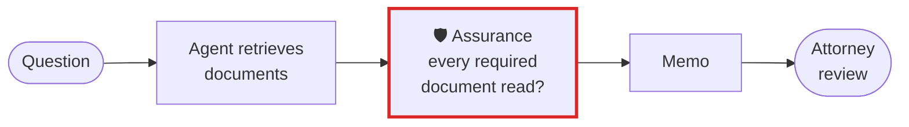

# Legal, insurance and document-heavy work

**A research or claims agent answers from what it retrieved. Assurance checks whether it retrieved
everything the matter needed, and whether the reports it relies on are complete.**

## What goes wrong

A legal research agent writes a confident memo from four of the six documents the matter requires.
A claims agent summarises a year of monthly reports with March missing. The answer reads complete,
and nothing in it says what was never read.

## The workflow, with Assurance in it



The red box is Assurance. Everything around it is your workflow as it is today.

## Set it up

List what the question needs, by any key you can name (document ids, exhibit numbers, policy ids),
and compare it with what the agent actually retrieved:

```bash
assurance diff --expected needed.txt --found retrieved.json --fail-on-gap
# 2 of 5 items — not in the found set: doc-2, doc-3, doc-5
# also present and not expected: doc-9
```

Check a folder of dated reports before an agent summarises it:

```bash
assurance check reports/ --expect monthly --from 2025-01 --to 2025-12 --fail-on-gap
```

If the agent is your own code, have it write a run record with the outputs it is expected to produce
(`expect`), and audit the run: an expected file it never wrote is named.
[Your own agent](../guide/your-own-agent.md) shows the format.

## What you get

- The exact documents or periods that are missing, by name, not a score.
- Items retrieved that the question did not call for, listed separately.
- An exit code a pipeline can stop on: `0` complete, `1` a gap or something it could not check,
  `2` could not run.

## What it does not do

It does not judge whether the memo is right. It tells you whether the agent read what you said the
question needs, which is the part a reviewer cannot see from the answer.

[All use cases](README.md) · [Back to the README](../../README.md)
