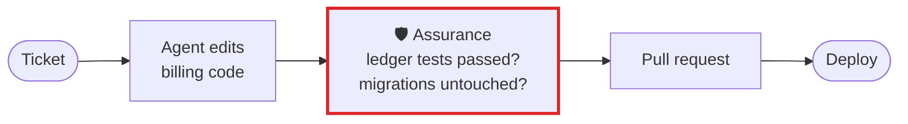

# Payments and fintech

**An agent fixes money code and says "done". Assurance checks that the tests the money depends on
ran after the fix, and passed.**

## What goes wrong

A rounding fix in `invoice.py` looks right, the agent says *"All done, the totals are correct now"*,
and the reconciliation test last ran before the final edit, and failed. Nobody reads the transcript,
so the change ships on the agent's word. In money code an off-by-one-cent bug is a ledger break, a
refund dispute and an audit finding.

## The workflow, with Assurance in it



The red box is Assurance. Everything around it is your workflow as it is today.

## Set it up

Declare what must pass and what an agent must not touch, and commit the file so every engineer's
audit knows it:

```toml
# .assurance/config.toml
[audit]
tests = ["./scripts/reconcile.sh"]              # your own script now counts as a test
must_run = ["pytest -q tests/test_ledger.py"]   # must pass after the last code edit
must_not_touch = ["migrations/", "ledger/schema.sql"]
```

Turn the hook on for everyone working on the repository:

```bash
uvx assurance@latest hook install --scope project
```

If your own agent moves money, have it write a run record and declare the outcome you care about, so
the audit can hold its "done" against it:

```python
from assurance_budget.record import Recorder

with Recorder("run.jsonl") as rec:
    rec.task("Fix the refund rounding", must_run=["pytest -q tests/test_ledger.py"])
    ...
    rec.outcome("refund total matches the ledger", passed=total == ledger)
    rec.claim("Done")
```

```bash
assurance audit run.jsonl --fail-on-outcome --fail-on-claim   # exit 1 stops the pipeline
```

## What you get

- After a turn that changed billing code with nothing tested: a **note** naming
  `pytest -q tests/test_ledger.py`, the command your project says must pass.
- When the ledger test failed after the last edit, or the agent says the tests pass when they did
  not: a **suggested review**, and with `--nudge` the agent is asked to fix it or say why not.
- A push, merge or deploy over billing code with no passing test after it: **stop and check**.
- A change to `migrations/` your last prompt did not ask for: a **suggested review** naming the file.

## What it does not do

It does not decide whether the rounding is right. It tells you whether the checks you declared ran
after the last change and passed, and says plainly what it could not see.

[All use cases](README.md) · [Back to the README](../../README.md)
