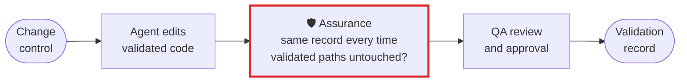

# Pharma, clinical and validated systems

**A validated system asks who did what, whether it was checked, and whether you can show it again
next year. Assurance writes that record from the session itself, by arithmetic, so the same session
produces the same record every time it is asked.**

## What goes wrong

A validated application has a change control procedure, and an agent session fits none of it. The
session ends with a summary the model wrote about its own work, which is attributable to nobody and
reproducible by nothing. A reviewer either trusts it or reads the whole transcript. So the agent is
kept out of validated code entirely, and the team runs two speeds: fast everywhere else, manual here.

## The workflow, with Assurance in it



The red box is Assurance. Everything around it is your procedure as it is today.

## Set it up

Name the code that carries validation, and the checks that must have passed after the last change to
it. Commit the file, so every engineer's session is held to the same declaration:

```toml
# .assurance/config.toml
[audit]
must_run = ["pytest -q tests/test_dose_calc.py"]
must_not_touch = ["validated/", "config/21cfr11.yaml", "fixtures/subjects/"]
```

Keep the record with the change, the way you keep any other controlled document:

```bash
assurance audit --json > evidence/CR-2211.json
```

## What you get

- **A record that reproduces.** The report is arithmetic over the transcript with no model in the
  path, so producing it twice gives the same bytes. "Re-run the audit and compare" is a check a QA
  reviewer can actually make, and a record that drifts between runs is not evidence.
- **A declaration the session cannot edit its way out of.** A session that changes
  `.assurance/config.toml` does not get to use what it declares there, and the report says that
  happened. An agent cannot take `validated/` off the list and then change it quietly.
- **The deliverable, checked.** Declare the outputs a run owes you and an expected file nothing
  wrote is named, rather than assumed from a run that exited 0.
- **Local.** It calls no model and no network service, so it runs on a qualified workstation without
  a new vendor in the GxP boundary.

## What it does not do

It is not validation, it does not approve a change, and it is not a Part 11 compliance claim about
your system. It produces evidence about one agent session, which your own procedure then uses.

Tested: [`test_pharma_the_same_session_produces_a_byte_identical_record`][t] and the scenarios beside
it. Every claim on this page has one.

[t]: ../../packages/budget/tests/test_use_case_scenarios.py

[All use cases](README.md) · [Back to the README](../../README.md)
