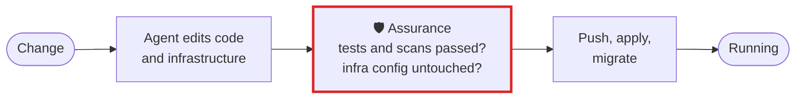

# Platform, DevOps and SRE

**Agents now push, deploy and run migrations. Assurance says, the moment one does it over untested
code, which edit it shipped and what never passed after it.**

## What goes wrong

An agent edits a service, runs nothing, and pushes, or runs `kubectl apply` or a migration. It changes
a module three teams depend on. It installs a package whose install script runs on your build machine.
Each step succeeded, so the agent reports success.

## The workflow, with Assurance in it



The red box is Assurance. Everything around it is your workflow as it is today.

## Set it up

```toml
# .assurance/config.toml
[audit]
checks = ["make lint", "terraform validate"]
must_run = ["make test"]
must_not_touch = [".github/workflows/", "infra/prod/", "*.lock"]
```

```bash
uvx assurance@latest hook install --scope project   # every engineer's sessions, the same rules
```

What a change reaches, symbol by symbol, from a graph built without a model:

```bash
graphify update .
assurance reach src/billing/money.py    # --json for a program, --depth to follow further
```

What an install will run, before it runs:

```bash
assurance deps package.json
# Of the 100 read, 2 execute code when installed:
#   · esbuild 0.23.1   node install.js
#   · sharp 0.33.5   node install/check
```

Hard limits a session cannot raise, for runaway loops and spend:

```toml
# ~/.config/assurance/config.toml  (yours, not the repository's)
[budget]
tool_calls = 400
seconds = 3600
```

## What you get

- **stop and check** on a push, merge, publish, deploy, migration or commit on main with code that no
  passing test or check followed, naming the edit and the command.
- A **suggested review** when `.github/workflows/` or `infra/prod/` changed without being asked for.
- Security and infrastructure scans are read: semgrep, trivy, gitleaks, checkov, `pip-audit`,
  `npm audit`, `terraform validate`, `helm lint`. One that fails after the last edit is a **suggested
  review**, quoting what it printed; one that passes does not count as testing your code, and
  `terraform validate && terraform apply` over untested code is still a **stop and check**.
- Commands are read from where they ran: a push in another repository is not counted as this one's.

## What it does not do

It does not block the push; it tells you, and asks the agent, right after the turn that did it. It
reads only what is on disk and in the transcript, and names what it could not classify.

[All use cases](README.md) · [Back to the README](../../README.md)
