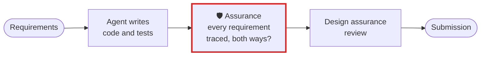

# Safety-critical software: automotive, aerospace, medical devices

**A design assurance review asks which requirements have a test behind them. Assurance answers it as
a set difference, names both sides of the gap, and exits non-zero so a build cannot pass over it.**

## What goes wrong

A trace matrix is maintained by hand, or generated by the same pipeline that would have to admit it
is incomplete. An agent adds code and tests for four of the six requirements it was given, and the
summary says the work is done. The requirement with no test behind it is found in a review months
later, or not at all. The reverse happens too: a suite citing a requirement id that was withdrawn,
which reads as coverage and is not.

## The workflow, with Assurance in it



The red box is Assurance. Everything around it is your process as it is today.

## Set it up

List the requirement ids, and the ids your suite actually traces. Any key you can name works — there
is no format to adopt:

```bash
assurance diff --expected requirements.txt --found covered.json --fail-on-gap
# 4 of 6 items — not in the found set: SR-003, SR-005
# also present and not expected: SR-099
```

Exit `1` means a gap, so a CI step stops on it. And declare the test that must pass after any change
to the code under review:

```toml
# .assurance/config.toml
[audit]
must_run = ["ctest --test-dir build"]
must_not_touch = ["certified/", "tables/"]
```

## What you get

- **Both directions of the gap.** A requirement with no test is named. So is a test citing a
  requirement that does not exist, which is the direction people forget and which reads as coverage
  until someone checks.
- **Names, not a percentage.** `SR-003, SR-005`, not "67% traced". A number cannot be actioned in a
  review and a name can.
- **An exit code.** `--fail-on-gap` returns 1, so the trace is a gate rather than a report somebody
  reads later.
- **No model deciding any of it.** It is a set difference over keys you supplied.

## What it does not do

It does not read your requirements or judge whether a test actually exercises one — it compares the
sets you give it. It is not a qualified tool under DO-178C or ISO 26262, and it does not produce a
certification artifact.

Tested: [`test_safety_critical_requirements_with_no_test_behind_them_are_named`][t], with the
withdrawn-requirement direction and a complete trace beside it.

[t]: ../../packages/cli/tests/test_use_case_scenarios.py

[All use cases](README.md) · [Back to the README](../../README.md)
